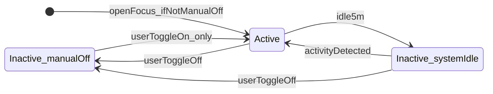

# Productivity measurement UX rethink

## Verdict

Replace the timer play-button + productivity-integrity + workspace-accountability stack with **one universal Focus session flow**. Measurement = time while the session is **Active**. Same behavior for every user — no “accountability on/off” custom paths.

## Product model

### Primary control

On [`focus/page.js`](src/app/(b2c)/(protected)/focus/page.js), top-right beside Theme:

```
[ Session toggle ] [ Theme ]
```

New `FocusSessionToggle` — same glass chrome as Theme, **Focus page only**. One click flips Active ↔ Inactive. Craft: mindblowing but still just a toggle (clear Focusing/Away states, springy motion, calm breath when Active).

### Lifecycle


| Event                                        | Session state                                           | Feedback                                                    |
| -------------------------------------------- | ------------------------------------------------------- | ----------------------------------------------------------- |
| User opens `/focus`                          | → **Active** (unless **manual-off** sticky — see below) | Optional subtle confirm; no blocking prompt                 |
| User toggles **Active**                      | Active; clears manual-off sticky                        | —                                                           |
| User toggles **Inactive**                    | Inactive; sets **manual-off sticky**                    | —                                                           |
| No activity ≥ **5 minutes** while Active     | → **Inactive** (system pause, not manual-off)           | Toast: e.g. focus session paused due to inactivity (5+ min) |
| Activity resumes after **system** idle pause | → **Active** again                                      | Toast: e.g. “Welcome back — focus session is live again”    |
| Activity while **manual-off**                | Stays Inactive                                          | No auto-on; user must toggle Active                         |


**Sticky manual-off:** If the user turned the session off themselves, the app must **never** auto-reactivate (not on Focus open, not on activity, not on toast). Only their toggle turns it back on.

**Leaving Focus** does not Inactive the session — they can work on Tasks/Home while Active.

**Ambience / Timer:** Optional. Neither is the measurement gate. Timer can still offer Pomodoro structure later; logging follows session Active, not Timer play.

### Toasts vs prompts

- **Use:** short informational toasts for auto Inactive / auto Welcome back.
- **Remove:** `[StillWorkingPrompt](src/components/focus/StillWorkingPrompt.js)` and any “Are you still focusing?” confirm/dismiss flow. That pattern was for integrity (timer keeps running, zero `active_seconds`) and is hard for users / wrong for this model.




## Retire productivity integrity

Integrity existed to police **timer-centric claims** (pinned task, `active_seconds`, `is_credited`, caps, Still focusing?). With session Active as the gate + idle auto-Inactive, that stack is redundant.

**Stop using / remove from product behavior:**

- Credited vs claimed split for “verified focus” (`[productivityIntegrity.js](src/lib/productivityIntegrity.js)`)
- Writing integrity fields as the source of truth for scores (`is_credited`, attentive-only credit, pin-task-required-for-credit)
- Timer-keeps-running-while-unattentive + Still Working prompt path in `[TimerContext.js](src/contexts/TimerContext.js)`
- Analysis / B2B copy and math that privilege “verified” over raw Active minutes (`[memberPersonalStats.js](src/lib/b2b/memberPersonalStats.js)`, analysis score helpers)

**New measurement rule:** Sum `duration_seconds` (or equivalent) for chunks logged while the Focus session was Active. Idle time after auto-Inactive simply is not logged.

**Implementation stance:** Retire the integrity *behavior* in app code and scoring. Leave DB columns unused or stop writing them in a follow-through cleanup so we don’t block on a migration; no new integrity features.

## Remove workspace accountability settings

The old dual path (`member_activity_monitoring` / “accountability”) only existed so some workspace members got Still Working + attentive `active_seconds` while others did not. The new session flow is universal — **no custom accountability mode**.

**Remove from product UI and branching:**

- Activity monitoring / accountability controls in [`OrgSettingsForm.js`](src/components/b2b/OrgSettingsForm.js)
- Setting persistence / activity-feed events in [`o/actions.js`](src/app/(b2b)/o/actions.js)
- API gate [`api/b2b/member-activity-monitoring`](src/app/api/b2b/member-activity-monitoring/route.js)
- Lookups like `userRequiresMemberActivityMonitoring` in [`org.js`](src/lib/org.js)
- Accountability pills / copy in [`WorkspaceDirectory.js`](src/components/b2b/WorkspaceDirectory.js), [`OrgPulseDashboard.js`](src/components/b2b/OrgPulseDashboard.js), and related summaries ([`workspaceSummaries.js`](src/lib/workspaceSummaries.js))
- TimerContext branching that only enables idle surveillance when monitoring is on — idle 5m auto-Inactive applies to **everyone**

**DB:** Stop reading/writing `organizations.member_activity_monitoring` in app code. Column can remain unused for now (no blocking migration required).

## What we are not doing

- Global mini control on other pages
- Auto-pause merely because the user left `/focus`
- Auto-on after the user manually set Inactive
- “Still focusing?” confirm toasts
- Keeping integrity credit as a parallel truth beside the toggle
- Keeping workspace accountability on/off as a second productivity flow

## Locked decisions

1. Toggle beside Theme = Active/Inactive source of truth
2. Open Focus → Active (unless manual-off sticky)
3. 5 min idle → Inactive + info toast
4. Activity after system idle → Active + welcome-back toast
5. Manual Inactive → sticky until manual Active
6. Session continues across other pages while Active
7. Retire productivity-integrity + Still Working UX; measure Active session time
8. Remove workspace accountability / member activity monitoring — one flow for all users

## Implementation touchpoints (when approved)

- `FocusSessionToggle` + Focus page chrome  
- Session state machine in [`TimerContext.js`](src/contexts/TimerContext.js) (or dedicated session module): Active flag, `manualOff` sticky, idle 5m, activity resume, flush only while Active  
- Toasts for auto off / welcome back  
- Remove [`StillWorkingPrompt`](src/components/focus/StillWorkingPrompt.js) host from [`AppSessionProviders.js`](src/components/AppSessionProviders.js)  
- Simplify logging in [`userStorage.js`](src/utils/userStorage.js) (stop depending on integrity builders for product meaning)  
- Point Analysis / B2B focus minutes at Active duration  
- Strip accountability settings + monitoring gates from B2B settings, directory, pulse, org helpers, and the monitoring API  
- Help copy updates  

No code until you confirm.